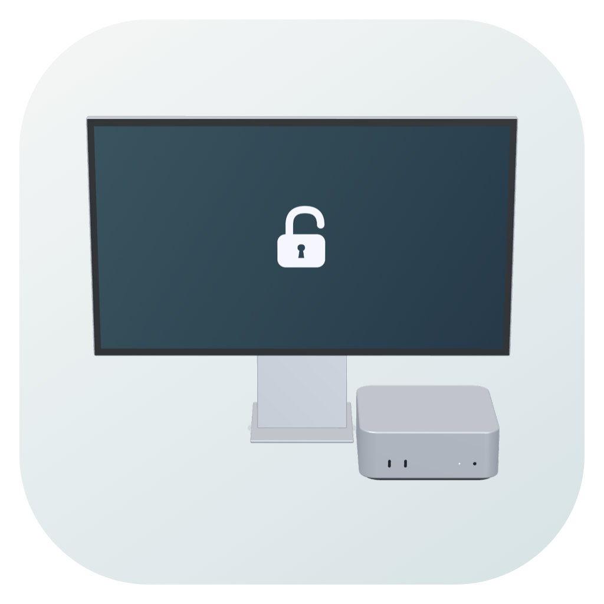

# Mac Session Helper



Mac Session Helper unlocks the screen on your Mac mini so Codex can use desktop apps. When the last desktop task releases access, the helper locks the screen again.

You handle the first sign-in after a restart. Then you can leave the screen locked between tasks, even on a Mac mini without an attached keyboard or monitor.

**Alpha, v1.0.6. Use at your own risk.** Keep a way to reach the Mac and lock or unlock it yourself. Review the known limitations before enrolling your login password.

- The helper stores the login password in the local Keychain. Processes running as your user can request an unlock, and focus can change between the helper's final check and simulated keyboard input.
- Display wake has failed intermittently. In one test, a task lost its lease and the desktop stayed unlocked until an explicit lock. Check the locked state after each task.
- Live testing covers one Apple Silicon Mac mini. Unattended operation, other hardware and independent security review are still pending.

See the [validation record](docs/VALIDATION.md) for test results and the [security review](docs/SECURITY-AUDIT.md) for open risks.

## Boundaries

- The helper needs an authenticated console session. It cannot perform the first login after shutdown or restart, including FileVault unlock.
- No automatic login, system daemon, network listener, telemetry or updater is installed.
- The CLI never accepts or returns a password. Enrollment happens in the app's secure field.
- A failed password attempt blocks further attempts until successful local enrollment. Never delete the latch to retry.
- Any process running as the same user can request access. This does not protect against malware running as that account.

Read [SECURITY.md](SECURITY.md) before using the helper. Focus checks and synthetic keyboard input are not atomic, and Swift cannot guarantee that every transient password copy is wiped from memory.

## Headless setup requirements

Headless setups can run without a directly attached keyboard or monitor. After a restart, the helper resumes when macOS has an authenticated console session for the account. Complete the first login yourself if macOS is waiting at the login screen. Arrange a way to reach the Mac for that login and for permission or credential recovery before relying on remote automation.

The helper runs in the account's existing graphical session through an Aqua LaunchAgent. An SSH connection alone does not create that session. The desktop must remain available to macOS, and the helper must be able to wake it and verify the login field. Operation with every monitor, display adapter and remote-access configuration has not been verified.

The app declares macOS 14.0 as its minimum. Live testing covers one Apple Silicon Mac mini on macOS 27.2 and 27.2.1. The installed helper unlocked and relocked the desktop after the 27.2.1 update and restart, once a console session already existed. See the [validation record](docs/VALIDATION.md).

## Build and install

Build this alpha from source. You need Git, Xcode Command Line Tools with the macOS SDK and Swift compiler, and Python 3. The installer uses `/usr/bin/python3`.

Run as the logged-in user, without sudo:

```sh
git clone https://github.com/numeono/mac-session-helper.git
cd mac-session-helper
zsh test.sh
zsh install.sh
export PATH="$HOME/.local/bin:$PATH"
mac-session status
```

Add `~/.local/bin` to your shell's PATH if needed, or invoke `~/.local/bin/mac-session` directly. Installation starts the helper for the current graphical session and registers it to start at future logins.

The app installs at `~/Applications/Mac Session Helper.app`, the client at `~/.local/bin/mac-session`, and an Aqua LaunchAgent at `~/Library/LaunchAgents/local.mads.MacSessionHelper.plist`. The legacy bundle identifier remains `local.mads.MacSessionHelper` to preserve existing installations; it is not a credential.

The default build is ad-hoc signed. A rebuild may require removing and re-adding the installed app in Privacy & Security → Device Control and Data Access, plus local password enrollment. On older macOS versions this permission is named Accessibility. For development with an existing code-signing identity, set `SIGNING_IDENTITY` when building. No signing certificate or private key is bundled.

For first-time setup:

1. Open `~/Applications/Mac Session Helper.app`. Grant that exact installed app Device Control and Data Access, or Accessibility on older macOS versions.
2. Choose Password setup in its status window. Enter the Mac login password locally and dismiss the success message. Never put the password in a command, script, issue or agent conversation.
3. Check `mac-session status`. Confirm `accessibility`, `credential_saved`, `eligible_session` and `enabled` are true, and `attempt_blocked` is false. `credential_saved` only proves that an entry exists; it does not prove the current app can read it.
4. While unlocked and with no other desktop tasks, run `mac-session test-cycle`. This deliberately locks, unlocks and relocks the desktop. Have a recovery path ready.
5. Test a separate task from a locked desktop and verify actual app access, lease release and the final locked state. Also test your normal display-sleep condition before using the helper remotely.

A build passing unit tests is not proof of successful desktop unlocking. See [troubleshooting](docs/TROUBLESHOOTING.md) if setup or a live test fails.

## Task use

Use your usual computer-use tools after `mac-session begin` succeeds. Shell-only tasks can run with the screen locked.

```sh
mac-session status
mac-session begin --seconds 900
mac-session renew LEASE_FROM_BEGIN --seconds 900
mac-session end LEASE_FROM_BEGIN
```

Each command returns JSON and exits nonzero on failure. Check `ok` before continuing. In a successful `begin` response, `unlocked` means the desktop was locked when the request began; it is false when the desktop was already unlocked. Save the returned lease. Renew only while actively working and end before waiting for a user or finishing.

Each concurrent task needs its own lease, which lasts 30 to 900 seconds. Ending the last lease locks only a desktop the helper unlocked. A manual lock revokes leases; renewal cannot unlock again.

Put lease release in your task's cleanup path and read `status` afterward. When the helper unlocked the desktop and no other task remains, verify `locked=true` and `active_tasks=0`. A missing-lease error does not prove that the desktop is locked. See [troubleshooting](docs/TROUBLESHOOTING.md) for recovery without interrupting other work.

`mac-session pause` disables unlocking and locks. Resume from the local menu. `mac-session lock` locks immediately. `mac-session setup` explicitly opens local enrollment. `mac-session wake-check` only requests and checks display wake; it does not retrieve or type the password, unlock the session, or clear the failure latch.

The helper also has a 15-minute idle lock. It leaves native energy and password-grace settings unchanged. Leases are never restored after a restart. A same-session recovery marker allows a restarted helper to relock a desktop it previously unlocked.

## Testing

`test.sh` runs session/lease policy, protocol validation, stable-focus/display-readiness, modal-loop and trusted-process tests. The signature test checks the system loginwindow when available. `zsh test.sh --live-display` additionally sleeps and wakes the actual display without reading or typing a credential. Do not run it during someone else's desktop task.

`Tests/runtime_protocol.py` checks only malformed requests and status against an installed helper; it never requests unlocking. `Tests/protocol_test.py` is an older pre-enrollment test and refuses to run after enrollment.

Full release verification must also cover real awake and display-asleep unlocks, concurrent leases, expiry, manual lock revocation, crash recovery, local setup failures and account/session changes.

## Removal and recovery

Run `mac-session pause` first, then unload the user LaunchAgent:

```sh
launchctl bootout "gui/$(id -u)/local.mads.MacSessionHelper"
```

Move the installed app, client and LaunchAgent to Trash. Runtime files live under `~/Library/Application Support/MacSessionHelper`. Installer backups live under `~/Library/Application Support/MacSessionHelperBackups` and are never committed.

If desired, remove only the `Mac Session Helper (local session only)` item in Keychain Access. Never delete the login Keychain or unrelated items. The installer does not modify TCC permissions, FileVault or credentials.

## Provenance and release status

The approach was informed by [BLEUnlock](https://github.com/ts1/BLEUnlock), but this is a separate implementation with task leases and additional target checks. No upstream source file is vendored. It uses Apple's private lock API and deprecated Keychain ACL APIs, so compatibility is not guaranteed across macOS versions.

The project is available under the [MIT license](LICENSE). The app uses [original icon artwork](assets/PROVENANCE.md). Developer ID signing, notarization and release packaging are still pending.

## Contributions and bug reports

See [CONTRIBUTING.md](CONTRIBUTING.md) for development checks and bug reports. For security findings, follow [SECURITY.md](SECURITY.md).
